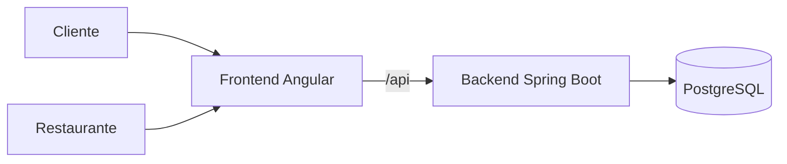
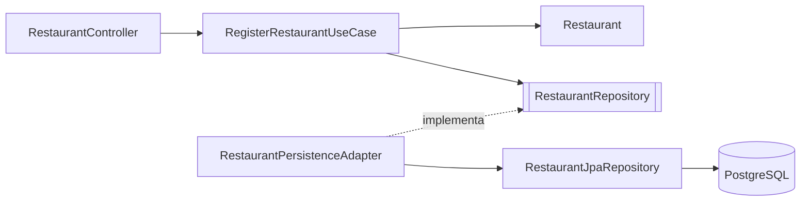

# Arquitectura

Pedidos es un monolito modular: un backend Spring Boot, un frontend Angular y una base PostgreSQL.
La razón de la elección está en [ADR-0002](adr/0002-arquitectura-hexagonal-por-modulos.md).



## Backend: hexagonal por módulos

Cada módulo representa una parte del negocio y tiene la misma forma por dentro. Los módulos previstos
son una guía, no una lista cerrada; un módulo se crea cuando la primera historia lo necesita.

| Módulo       | Responsabilidad                                  |
| ------------ | ------------------------------------------------ |
| `identity`   | Usuarios, registro, inicio de sesión y roles     |
| `restaurant` | Registro y datos de los restaurantes             |
| `catalog`    | Productos y categorías del menú de cada local    |
| `order`      | Carrito confirmado, pedidos y su ciclo de estado |

```text
com.nur.pedidos
├── <modulo>/
│   ├── domain/
│   │   ├── model/          Entidades y value objects en Java puro
│   │   ├── port/           Interfaces que el dominio necesita (RestaurantRepository)
│   │   └── exception/      Errores de negocio del módulo
│   ├── application/        Un caso de uso por clase + commands
│   └── infrastructure/
│       ├── persistence/    @Entity, repositorios Spring Data y adaptadores de los puertos
│       └── web/            Controllers, requests y responses
└── shared/
    ├── domain/exception/   DomainException, NotFoundException
    └── infrastructure/web/ GlobalExceptionHandler, HealthController
```

### Recorrido de una petición



El controller convierte el request en un command y llama al caso de uso. El caso de uso aplica las
reglas del dominio y guarda a través del puerto. El adaptador traduce entre el modelo de dominio y la
entidad JPA. El dominio no sabe que existen Spring, JPA ni HTTP.

### Reglas de dependencia

Están verificadas por `ArchitectureTest` (ArchUnit). Si una falla, `./mvnw verify` falla.

1. `domain` no depende de Spring, JPA, Hibernate ni Jackson.
2. `domain` no depende de `application` ni de `infrastructure`.
3. `application` no depende de `infrastructure`.
4. La `infrastructure` de un módulo no usa la `infrastructure` de otro.
5. `shared` no depende de ningún módulo.
6. Las clases `@Entity` viven en `infrastructure.persistence` y terminan en `Entity`.
7. Los repositorios de Spring Data viven en `infrastructure.persistence`.
8. Los `@RestController` viven en `infrastructure.web` y terminan en `Controller`.
9. Los `@Service` de `application` terminan en `UseCase`.

### Comunicación entre módulos

Un módulo no toca la base de datos ni las clases de infraestructura de otro. Si `order` necesita
datos de `catalog`, define un puerto propio (`order/domain/port/ProductCatalog`) y un adaptador en
`order/infrastructure` que llama a los casos de uso de `catalog`. Así cada módulo puede cambiar por
dentro sin romper a los demás.

### Cuándo el dominio tiene lógica

Las reglas del negocio viven en el modelo de dominio: un pedido calcula su total y decide qué cambios
de estado son válidos; un restaurante sabe si puede recibir pedidos. En módulos que son casi CRUD el
modelo es simple, pero las capas se mantienen igual en todos los módulos para que el código sea
predecible.

## Frontend: features aisladas

```text
src/app/
├── core/          Servicios únicos de toda la app: autenticación, interceptores, errores
├── shared/
│   ├── ui/        Componentes visuales reutilizables sin lógica de negocio
│   └── utils/     Funciones puras y pipes
├── layout/        Estructura de la app: header, navegación, footer
└── features/
    └── <feature>/
        ├── <feature>.routes.ts
        ├── pages/        Componentes enrutados: cargan datos y manejan estado
        ├── components/   Componentes de presentación: reciben inputs y emiten outputs
        ├── data-access/  Clientes HTTP (XxxApi) y estado compartido (XxxStore)
        └── models/       Interfaces y tipos
```

| Feature prevista   | Contenido                                       |
| ------------------ | ----------------------------------------------- |
| `auth`             | Registro e inicio de sesión                     |
| `restaurants`      | Explorar restaurantes y ver su menú             |
| `cart`             | Carrito y confirmación del pedido               |
| `orders`           | Historial y estado de los pedidos del cliente   |
| `restaurant-admin` | Panel del restaurante: datos, catálogo, pedidos |

### Reglas de importación

Están verificadas por ESLint (`eslint-plugin-boundaries`). Si una falla, `npm run lint` falla.

| Desde          | Puede importar                                       |
| -------------- | ---------------------------------------------------- |
| `features/<x>` | `core`, `shared`, `environments` y su propia feature |
| `layout`       | `core`, `shared`, `environments`                     |
| `core`         | `core`, `environments`                               |
| `shared`       | `shared`                                             |
| `app.*` (raíz) | todo                                                 |

Una feature nunca importa de otra. Si dos features necesitan lo mismo, se mueve a `shared` (si es
visual o una utilidad) o a `core` (si es un servicio global).
