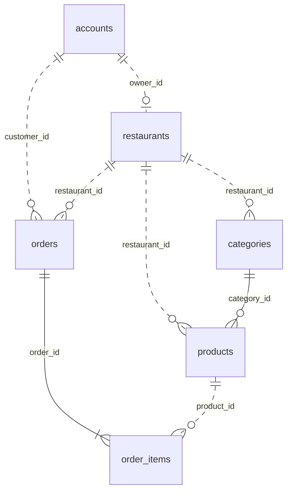
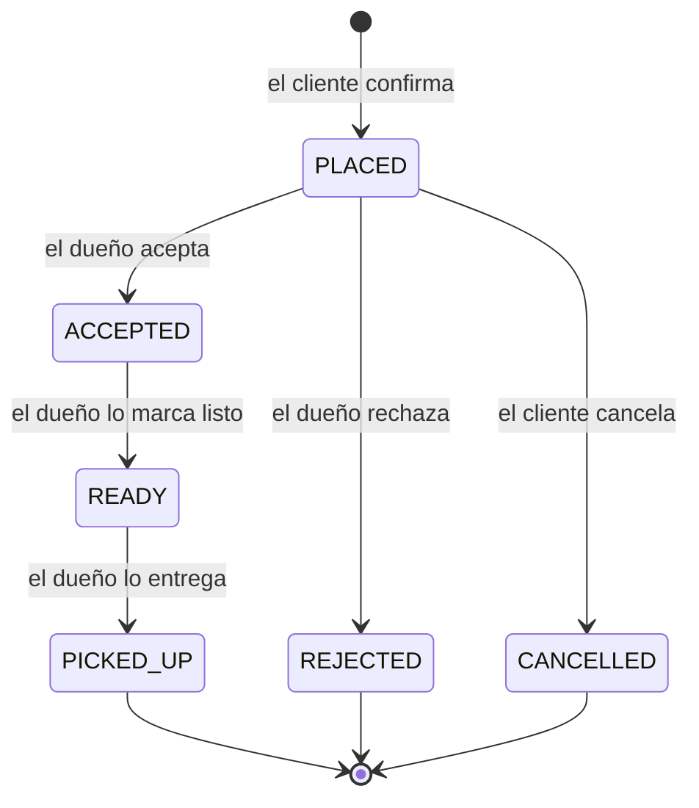

# Modelo de datos

Las tablas de cada módulo, sus restricciones y las reglas de negocio que dependen de ellas. La
decisión y sus alternativas están en [ADR-0009](adr/0009-modelo-de-datos-y-migraciones-con-flyway.md);
cómo se escriben las migraciones, en [backend.md](convenciones/backend.md#migraciones).

Cada tabla entra con la migración de la feature que la usa. Las de `identity` ya existen
(`V1__create_accounts.sql`); las demás todavía no.

## Vista general

La línea continua es una clave foránea dentro del módulo. La punteada es el id de una tabla de otro
módulo: una columna `bigint` con índice, sin clave foránea ni relación JPA.

| Módulo       | Tablas                                                    |
| ------------ | --------------------------------------------------------- |
| `identity`   | `accounts`, `spring_session`, `spring_session_attributes` |
| `restaurant` | `restaurants`                                             |
| `catalog`    | `categories`, `products`                                  |
| `order`      | `orders`, `order_items`                                   |

Todas las tablas usan `id bigint generated by default as identity primary key`. El dinero es
`numeric(12, 2)` en bolivianos y las fechas son `timestamptz`.

## `identity`

### `accounts`

| Columna         | Tipo           | Nulo | Notas                                                           |
| --------------- | -------------- | ---- | --------------------------------------------------------------- |
| `id`            | `bigint`       | no   |                                                                 |
| `name`          | `varchar(100)` | no   | Nombre para mostrar                                             |
| `email`         | `varchar(254)` | no   | Único. Se guarda sin espacios y en minúsculas                   |
| `password_hash` | `varchar(100)` | no   | BCrypt con el prefijo `{bcrypt}` de `DelegatingPasswordEncoder` |
| `role`          | `varchar(20)`  | no   | `CUSTOMER`, `OWNER` o `ADMIN`, con `check`                      |
| `suspended`     | `boolean`      | no   | `false` por defecto                                             |
| `created_at`    | `timestamptz`  | no   |                                                                 |

- El correo es único sin distinguir mayúsculas porque el dominio lo normaliza antes de guardarlo y
  la tabla tiene `unique (email)`. Registrar un correo existente responde `409` con
  `identity.email_taken`.
- El nombre es obligatorio, sin espacios a los costados. Es lo que muestra el encabezado y el panel
  del admin.
- El rol no cambia después del registro. La regla de la contraseña, el primer admin y la suspensión
  son los de [ADR-0008](adr/0008-autenticacion-con-sesion-y-roles.md).

### Sesiones

`spring_session` y `spring_session_attributes` son las tablas de Spring Session JDBC. Entran en la
misma migración que `accounts`, copiadas del `schema-postgresql.sql` que trae `spring-session-jdbc`,
y la aplicación arranca con `spring.session.jdbc.initialize-schema: never` para que solo Flyway cree
tablas. `principal_name` guarda el id de la cuenta como texto; por esa columna se borran las
sesiones de una cuenta suspendida.

## `restaurant`

### `restaurants`

| Columna       | Tipo           | Nulo | Notas                                     |
| ------------- | -------------- | ---- | ----------------------------------------- |
| `id`          | `bigint`       | no   |                                           |
| `owner_id`    | `bigint`       | no   | Único: un dueño tiene un solo restaurante |
| `name`        | `varchar(120)` | no   |                                           |
| `description` | `varchar(300)` | sí   | Texto corto para la tarjeta del listado   |
| `address`     | `varchar(200)` | no   | Dónde se retiran los pedidos              |
| `open`        | `boolean`      | no   | Lo cambia el dueño. `false` por defecto   |
| `suspended`   | `boolean`      | no   | Lo cambia el admin. `false` por defecto   |
| `created_at`  | `timestamptz`  | no   |                                           |

Un restaurante tiene dos estados independientes: abierto o cerrado, que decide el dueño, y
suspendido o no, que decide el admin.

| Estado     | Listado y menú públicos | Recibe pedidos | Pedidos en curso            |
| ---------- | ----------------------- | -------------- | --------------------------- |
| Abierto    | Visible                 | Sí             | El dueño los atiende        |
| Cerrado    | Visible, como "Cerrado" | No             | El dueño los atiende        |
| Suspendido | Oculto: responde `404`  | No             | El dueño los puede terminar |

- El dueño registra su restaurante una sola vez. Un segundo registro responde `409` con
  `restaurant.already_registered`, y `unique (owner_id)` lo respalda en la base.
- Un restaurante nuevo empieza cerrado: el dueño carga el menú y después lo abre.
- Suspender un restaurante también lo cierra. Al reactivarlo vuelve cerrado y el dueño decide cuándo
  abrir.
- Suspender la cuenta de un dueño no cambia su restaurante. Si el admin quiere sacar el local,
  también lo suspende.

## `catalog`

### `categories`

| Columna         | Tipo          | Nulo | Notas                                           |
| --------------- | ------------- | ---- | ----------------------------------------------- |
| `id`            | `bigint`      | no   |                                                 |
| `restaurant_id` | `bigint`      | no   | Id de `restaurants`                             |
| `name`          | `varchar(60)` | no   | Único por restaurante sin distinguir mayúsculas |

`categories_restaurant_id_name_key` es un índice único sobre `(restaurant_id, lower(name))`. El menú
muestra las categorías en el orden en que se crearon.

### `products`

| Columna         | Tipo            | Nulo | Notas                                                |
| --------------- | --------------- | ---- | ---------------------------------------------------- |
| `id`            | `bigint`        | no   |                                                      |
| `restaurant_id` | `bigint`        | no   | Id de `restaurants`; el mismo que el de su categoría |
| `category_id`   | `bigint`        | no   | Clave foránea a `categories`                         |
| `name`          | `varchar(120)`  | no   |                                                      |
| `description`   | `varchar(300)`  | sí   |                                                      |
| `price`         | `numeric(12,2)` | no   | `check (price > 0)`                                  |
| `available`     | `boolean`       | no   | `true` por defecto                                   |

- Un producto pertenece a una categoría de su mismo restaurante; el caso de uso lo verifica.
- Una categoría con productos no se puede borrar: responde `409` con `catalog.category_not_empty`,
  y la clave foránea lo respalda en la base.
- Un producto se puede borrar. Los pedidos que ya lo incluían no cambian, porque guardan su copia.
- Un producto no disponible sigue en el menú con `available: false`, para que la interfaz lo muestre
  como agotado, pero no se puede pedir.
- Cambiar el precio solo afecta a los pedidos que se confirmen después.

## `order`

### El carrito

El carrito no tiene tabla: vive en el frontend hasta que el cliente confirma. Está en `core/cart`
porque lo usan dos features (`restaurants` agrega productos y `cart` lo confirma), se guarda en
`localStorage` para que sobreviva a una recarga o al paso por el ingreso, y se vacía al confirmar o
al cerrar sesión. Tiene productos de un solo restaurante. Explorar restaurantes y menús no exige
sesión; confirmar exige el rol `CUSTOMER`.

### `orders`

| Columna           | Tipo            | Nulo | Notas                                    |
| ----------------- | --------------- | ---- | ---------------------------------------- |
| `id`              | `bigint`        | no   | Es también el número del pedido (#42)    |
| `customer_id`     | `bigint`        | no   | Id de `accounts`                         |
| `restaurant_id`   | `bigint`        | no   | Id de `restaurants`                      |
| `restaurant_name` | `varchar(120)`  | no   | Copia del nombre al confirmar            |
| `status`          | `varchar(20)`   | no   | Uno de los estados de abajo, con `check` |
| `total`           | `numeric(12,2)` | no   | `check (total > 0)`                      |
| `placed_at`       | `timestamptz`   | no   | Cuándo se confirmó                       |
| `updated_at`      | `timestamptz`   | no   | Último cambio de estado                  |

### `order_items`

| Columna        | Tipo            | Nulo | Notas                                      |
| -------------- | --------------- | ---- | ------------------------------------------ |
| `id`           | `bigint`        | no   |                                            |
| `order_id`     | `bigint`        | no   | Clave foránea a `orders`                   |
| `product_id`   | `bigint`        | no   | Id que tenía el producto en `products`     |
| `product_name` | `varchar(120)`  | no   | Copia del nombre al confirmar              |
| `unit_price`   | `numeric(12,2)` | no   | Copia del precio al confirmar, `check > 0` |
| `quantity`     | `integer`       | no   | `check (quantity between 1 and 99)`        |

`unique (order_id, product_id)`: un producto aparece una sola vez por pedido. `Order` y sus ítems
son un agregado que se guarda y se carga junto. Es la única relación JPA del modelo; las demás
claves foráneas se mapean como columnas `Long`.

### Confirmar un pedido

El frontend manda el restaurante y, por cada producto, su id y la cantidad. Nunca manda precios ni
el total. El caso de uso rechaza el pedido con `422` si:

| Regla                                                        | Código                         |
| ------------------------------------------------------------ | ------------------------------ |
| No tiene productos                                           | `order.empty`                  |
| Una cantidad está fuera de 1 a 99                            | `order.invalid_quantity`       |
| Un producto se repite                                        | `order.duplicate_product`      |
| El restaurante no existe, está cerrado o está suspendido     | `order.restaurant_unavailable` |
| Un producto no existe, es de otro restaurante o está agotado | `order.product_unavailable`    |

Si todo está bien, copia el nombre del restaurante y el nombre y el precio actual de cada producto,
calcula el total como la suma de precio por cantidad y crea el pedido en `PLACED`. Después de eso,
el pedido no depende del catálogo: editar, agotar o borrar un producto, o renombrar el restaurante,
no cambia los pedidos ya confirmados.

### Estados

No hay envío: el cliente retira el pedido en el local.

| Estado      | En la interfaz     | Método del dominio |
| ----------- | ------------------ | ------------------ |
| `PLACED`    | Pendiente          | `Order.place(...)` |
| `ACCEPTED`  | En preparación     | `accept()`         |
| `READY`     | Listo para retirar | `markReady()`      |
| `PICKED_UP` | Retirado           | `markPickedUp()`   |
| `REJECTED`  | Rechazado          | `reject()`         |
| `CANCELLED` | Cancelado          | `cancel()`         |

- Solo esas transiciones son válidas. Cualquier otra responde `409` con `order.invalid_transition`.
- El cliente solo ve y cancela sus pedidos, y el dueño solo los de su restaurante. Si no, `403` con
  `order.not_owner`.
- Cada transición actualiza `updated_at`. La hora sale de un `Clock`, así los tests la fijan.
- Una vez aceptado, el pedido ya no se cancela.

## Referencias entre módulos

| Columna                                              | Apunta a         | Quién garantiza que existe                               |
| ---------------------------------------------------- | ---------------- | -------------------------------------------------------- |
| `restaurants.owner_id`, `orders.customer_id`         | `accounts.id`    | Sale de la sesión (`CurrentUser`)                        |
| `categories.restaurant_id`, `products.restaurant_id` | `restaurants.id` | El caso de uso lo busca con un puerto hacia `restaurant` |
| `orders.restaurant_id`                               | `restaurants.id` | El puerto `RestaurantDirectory` de `order`               |
| `order_items.product_id`                             | `products.id`    | El puerto `ProductCatalog` de `order`, al confirmar      |

`order` depende de `catalog` y de `restaurant`; `catalog` depende de `restaurant`; `restaurant` e
`identity` no dependen de nadie. No hay ciclos.

## Imágenes

Las imágenes de restaurantes y productos se deciden en su propia ADR. El modelo ya las admite: son
opcionales, así que esa ADR agrega con su migración una columna nullable en `restaurants` y en
`products`, cuyo tipo depende del almacenamiento (una ruta, la clave de un objeto o el id de una
tabla de archivos). Los pedidos no copian la imagen. Mientras tanto, la interfaz muestra un
placeholder con el estilo de la marca.

## Fuera del modelo

Se dejaron afuera para mantener el alcance. Cada uno entra después con su propia migración si hace
falta: tipo de cocina, horarios de atención, teléfono del restaurante, orden manual de las
categorías, nota del pedido, nombre del cliente en el pedido, cancelar después de aceptar, reseñas y
favoritos.
